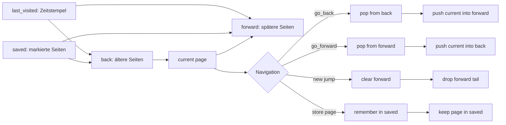
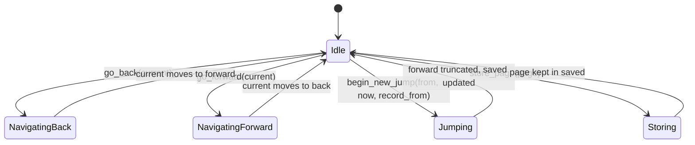
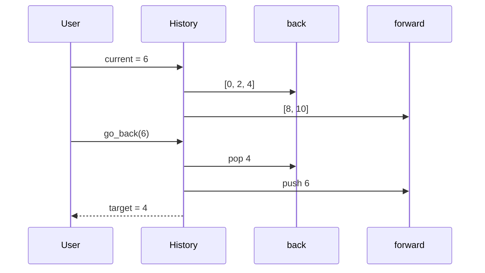
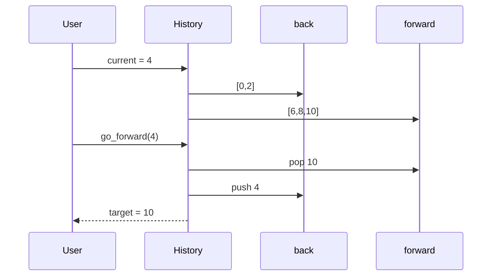
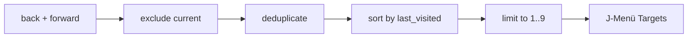
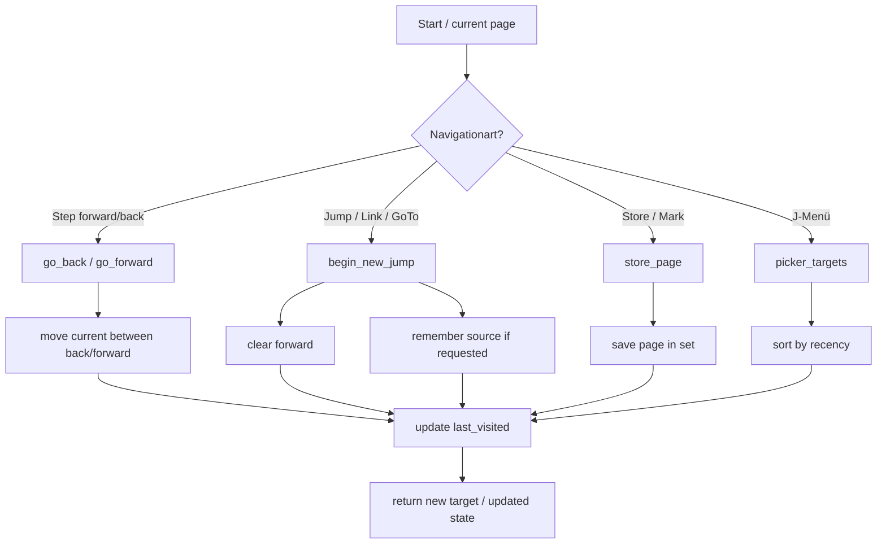

# History-Algorithmus von pdfpc_qt6

Dieses Dokument visualisiert den History-Mechanismus aus `rust/src/nav_history.rs`.

## 1. Grundmodell

Der Algorithmus modelliert Präsentationsnavigation als einen Pfad mit einem Cursor:

```text
[ ältere Seiten ... ]  <- back
        current
[ neuere Seiten ... ]  <- forward
```

Wichtige Zustände:

- `back`: Seiten, die wir hinter uns gelassen haben
- `current`: aktuelle Folie
- `forward`: Seiten, die wir noch vor uns haben
- `saved`: explizit gespeicherte / markierte Seiten
- `last_visited`: Zeitstempel des letzten Besuchs jeder Seite

---

## 2. Überblick als Mermaid-Diagramm



---

## 3. Zustandsmodell



---

## 4. Typische Ablauf-Szenarien

### 4.1 Einfacher Rückwärtslauf



Ergebnis:

```text
before:  back=[0,2,4], current=6, forward=[8,10]
after:   back=[0,2],   current=4, forward=[6,8,10]
```

### 4.2 Vorwärtslauf nach einem Rückgang



---

## 5. Die wichtigste Regel: Neuer Sprung verwirft nur den forward-tail

```mermaid
flowchart LR
    A[back = [0, 2]] --> C[current = 2]
    C --> B[forward = [4, 6]]

    C --> D[begin_new_jump(2)]
    D --> E[forward = []]
    D --> F[back bleibt erhalten]
    D --> G[Seiten 4 und 6 fallen weg]
```

Vorher:

```text
back    = [0, 2]
current = 2
forward = [4, 6]
```

Nach einem neuen Sprung auf 9:

```text
back    = [0, 2]
current = 9
forward = []
```

Das ist die zentrale Semantik des Algorithmus:
- Ein echter Sprung verwirft nur den zukünftigen Trail
- der bisherige Verlauf bleibt bestehen

---

## 6. Stack / Markierung (`saved`)

`remember(page)` legt eine Seite als “markiert” fest.

```mermaid
flowchart TD
    A[saved = {0, 2, 7}] --> B{Ist Seite schon in back oder forward?}
    B -->|Ja| C[keine Duplikate]
    B -->|Nein| D[Seite wird als markiert gespeichert]
    D --> E[trim_front]
```

Dieser Mechanismus dient als “jump stack” / “marker” für explizit gespeicherte Seiten.

---

## 7. J-Menü-Auswahl

`picker_targets()` sammelt alle relevanten Seiten aus `back` und `forward`, ignoriert `current`, und sortiert sie nach letzter Aktivität.



Beispiel:

```text
back    = [0, 2, 5]
forward = [8]
current = 5

=> targets = [2, 0, 8]

sortiert nach last_visited
```

---

## 8. Ablauf als Flowchart



---

## 9. Bewertung der Qualität

### Positiv

- klare Trennung zwischen `back`, `forward`, `saved` und `last_visited`
- gute Semantik für PDF-Navigation
- Rück-/Vorwärtslogik entspricht Browser-Modell
- “Sprung verwirft nur forward-tail” ist eine starke, verständliche Regel
- `picker_targets()` ist gut auf J-Menü-Auswahl zugeschnitten
- viele Tests im selben Modul dokumentieren das Verhalten

### Kritisch

- Die Zustände sind nicht trivial; man muss mehrere Strukturen gleichzeitig lesen
- `saved` ist nicht allein ein “Bookmark”-Set, sondern Teil des internen Navigationszustands
- Die Lesbarkeit ist gut, aber für Einsteiger nicht sofort intuitiv

### Gesamturteil

```text
Algorithmische Qualität: sehr gut
Lesbarkeit: gut bis mittel
Robustheit: sehr gut
Eignung für Präsentationssoftware: sehr gut
```

---

## 10. Kurzfazit

Der Algorithmus ist ein gut durchdachtes Browser-Style-History-Modell, das speziell für PDF-Präsentationen angepasst wurde:

- Rück-/Vorwärts bleibt konsistent
- Page-Jumps verwirfen nur den forward-tail
- gespeicherte Seiten bleiben sichtbar
- zuletzt besuchte Seiten lassen sich gut im J-Menü auswählen

Das macht den History-Mechanismus technisch sauber und gut testbar.

---

Verwandte Datei:
- `rust/src/nav_history.rs`
- `rust/src/session.rs`


