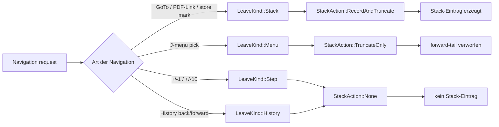
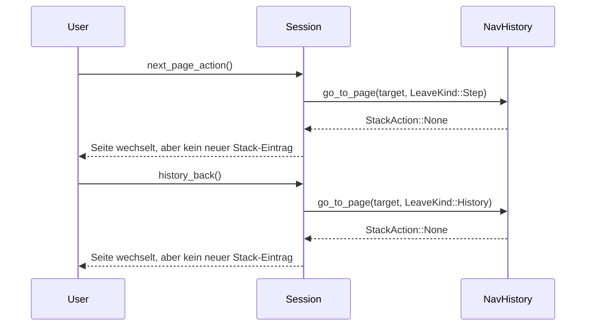
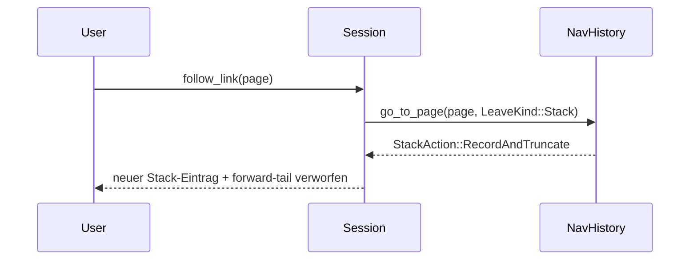

# History-Algorithmus von pdfpc_qt6

Dieses Dokument beschreibt den History-Mechanismus aus `rust/src/nav_history.rs` und die zugehörige Navigation aus `rust/src/session.rs`.

Wichtige Korrektur: Nicht alle Seitennavigationen erzeugen einen Stack-Eintrag. Das gilt insbesondere nicht für die normalen Schritt-Navigationen `+/- 1` und `+/- 10` sowie für die History-Back/Forward-Walks. Nur echte Sprünge wie GoTo, PDF-Link oder explizite Stack-Markierung erzeugen einen neuen Eintrag.

---

## 1. Navigationstypen im Code

Im Code gibt es vier relevante Navigationstypen:

```rust
enum LeaveKind {
    Stack,   // Go-to / PDF-Link / explicit stack mark
    Menu,    // J-menu pick
    Step,    // +/-1 / +/-10 page movement
    History, // back/forward history walk
}
```

Die Zuordnung zum Stack-Verhalten erfolgt hier:

```rust
fn stack_action(kind: LeaveKind) -> StackAction {
    match kind {
        LeaveKind::Stack => StackAction::RecordAndTruncate,
        LeaveKind::Menu => StackAction::TruncateOnly,
        LeaveKind::Step | LeaveKind::History => StackAction::None,
    }
}
```

Das ist die entscheidende Stelle:
- `Step` erzeugt keinen Stack-Eintrag
- `History` erzeugt keinen Stack-Eintrag
- nur `Stack` und `Menu` beeinflussen den Stack

---

## 2. Die vier Wege der Seitennavigation

### 2.1 Stack-Sprünge: GoTo, PDF-Link, explizite Stack-Markierung

Diese Wege rufen `go_to_page(target, LeaveKind::Stack)` auf:

```rust
fn stack_jump(self: Pin<&mut Self>, target: i32) {
    self.go_to_page(target, LeaveKind::Stack);
}
```

Und PDF-Links gehen ebenfalls darüber:

```rust
pub fn follow_link(self: Pin<&mut Self>, page: i32) {
    if *self.help_visible() || *self.recent_visible() || *self.history_visible() {
        return;
    }
    self.stack_jump(page);
}
```

Dabei gilt:
- `StackAction::RecordAndTruncate`
- die aktuelle Seite wird auf dem Stack gespeichert
- der Forward-Tail wird gelöscht

### 2.2 J-Menü-Sprung

```rust
fn menu_jump(self: Pin<&mut Self>, target: i32) {
    self.go_to_page(target, LeaveKind::Menu);
}
```

`Menu` entspricht:
- `StackAction::TruncateOnly`
- der Forward-Tail wird verworfen
- aber die verlassene Seite bleibt nicht als neuer Entry im Stack

### 2.3 Normale Schritte: +/-1 und +/-10

Diese beiden Pfade erzeugen keine Stack-Einträge.

```rust
pub fn next_page_action(self: Pin<&mut Self>) {
    self.jump_pages(1);
}

pub fn prev_page_action(self: Pin<&mut Self>) {
    self.jump_pages(-1);
}

fn jump_pages(self: Pin<&mut Self>, delta: i32) {
    if delta == 0 {
        return;
    }
    // ...
    let Some(target) = page_after_jump(cur, count, delta) else {
        return;
    };
    self.go_to_page(target, LeaveKind::Step);
}
```

`Step` ist in `stack_action()` ausdrücklich mit `StackAction::None` verknüpft.

Zusätzlich gilt für die Tastenlogik:

```rust
fn nav_key_delta(key: i32, shift: bool) -> Option<i32> {
    match key {
        KEY_RIGHT => Some(if shift { PAGE_SKIP } else { 1 }),
        KEY_LEFT => Some(if shift { -PAGE_SKIP } else { -1 }),
        KEY_DOWN | KEY_SPACE | KEY_RETURN | KEY_ENTER | KEY_PAGE_DOWN => Some(1),
        KEY_UP | KEY_BACKSPACE | KEY_PAGE_UP => Some(-1),
        _ => None,
    }
}
```

`PAGE_SKIP` ist 10, also genau die `+/-10`-Navigation. Auch diese Methode erzeugt keinen Stack-Eintrag.

### 2.4 History-Back/Forward

Diese Wege laufen ebenfalls ohne Stack-Eintrag:

```rust
pub fn history_back(mut self: Pin<&mut Self>) {
    let cur = *self.current_page();
    let target = self.as_mut().rust_mut().nav_history.go_back(cur, Instant::now());
    if let Some(target) = target {
        self.apply_history_page(target);
    }
}

pub fn history_forward(mut self: Pin<&mut Self>) {
    let cur = *self.current_page();
    let target = self.as_mut().rust_mut().nav_history.go_forward(cur, Instant::now());
    if let Some(target) = target {
        self.apply_history_page(target);
    }
}

fn apply_history_page(self: Pin<&mut Self>, target: i32) {
    self.go_to_page(target, LeaveKind::History);
}
```

Auch hier ist die entscheidende Zeile:

```rust
LeaveKind::Step | LeaveKind::History => StackAction::None,
```

Damit erzeugen Back/Forward-History-Walks keinen neuen Stack-Eintrag.

---

## 3. Grundmodell mit den drei Gruppen

```text
A) Stack-generierende Sprünge
   - GoTo (g)
   - PDF-Link
   - explizite Stack-Markierung (m)
   => LeaveKind::Stack
   => StackAction::RecordAndTruncate

B) Stack-modifizierende Sprünge
   - J-Menü pick
   => LeaveKind::Menu
   => StackAction::TruncateOnly

C) Nicht-Stack Navigation
   - +/-1 page
   - +/-10 page
   - Back/Forward history walk
   => LeaveKind::Step / LeaveKind::History
   => StackAction::None
```

---

## 4. Zustandsdiagramm mit korrekter Unterscheidung



---

## 5. Beispiel: +1/+10 und History-back sind keine Stack-Einträge



---

## 6. Beispiel: PDF-Link erzeugt einen Stack-Eintrag



---

## 7. Bewertung der Qualität

### Stärken

- Die Semantik ist klar durch ein `LeaveKind`-Enum getrennt
- `Step` und `History` sind explizit von Stack-Einträgen ausgeschlossen
- die Logik folgt sauber den Anforderungen einer PDF-Präsentation
- `+/-1` und `+/-10` bleiben “sequentielle Bewegung”, keine echte “Wiederherstellungs-Position”
- PDF-Links / GoTo / Stack-Markierungen werden als echte “jump points” modelliert

### Kritische Beobachtung

Das ist genau der Punkt, der im ersten Entwurf leicht übersehen wurde: Der Begriff “History” ist nicht identisch mit “Stack-Eintrag”.

In der Praxis gilt:
- History-Back/Forward = Verlaufspfad, aber kein Stack-Eintrag
- normaler Seitenwechsel = keine Stack-Record
- echte Sprünge = Stack-Eintrag

### Gesamturteil

```text
Algorithmische Qualität: sehr gut
Semantische Klarheit: sehr gut
Stack-Model: korrekt und intentional
Eignung für PDF-Präsentationssoftware: sehr gut
```

---

## 8. Kurzfazit

Der History-Mechanismus unterscheidet sauber zwischen:

- echten Sprüngen, die einen Stack-Eintrag erzeugen (GoTo, PDF-Link, Markierung), und
- Bewegungstypen, die keinen Eintrag erzeugen (`+/-1`, `+/-10`, Back/Forward-History)

Das ist exakt das richtige Verhalten für eine Präsentationssoftware, weil sequentielles Blättern nicht mit dem Sprung-Stack vermischt werden soll.

Verwandte Stellen im Code:
- `rust/src/nav_history.rs` — `LeaveKind`, `stack_action`, `go_back`, `go_forward`, `go_to_page`
- `rust/src/session.rs` — `jump_pages`, `follow_link`, `history_back`, `history_forward`
